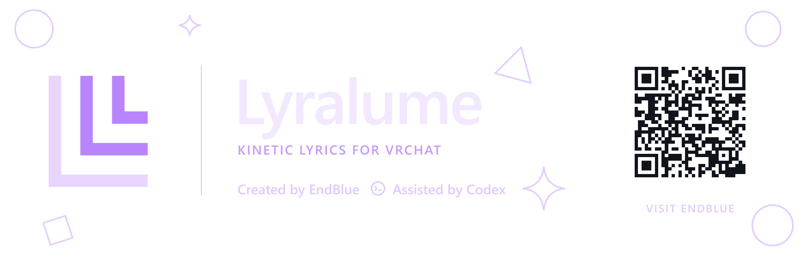

# Lyralume for VRC

**VizVid 專用的 VRChat 動態歌詞系統。**

Created by **EndBlue** · Assisted by Codex

提供逐字高亮、翻譯、羅馬音、音樂反應與封面顯示。一套 Lyralume 對應一台 VizVid，可指定多個螢幕；多台播放器各自分析自己的音源。

## 安裝

1. 在 Unity 2022.3 的 VRChat Worlds 專案安裝 Worlds SDK、VizVid 與 AudioLink。
2. 到 [Releases](../../releases/latest) 下載 `.unitypackage`，匯入專案並等待編譯完成。
3. 開啟 **Tools → Lyralume → 安裝與設定**。
4. 選擇 VizVid 播放器與要使用的螢幕，再安裝。
5. 設定自己的相容 API，儲存場景並執行 **Build & Test**。

完整步驟請見 [安裝教學](Assets/Lyralume/Documentation/安裝教學.md)。安裝包包含完整原始碼及資產，不需要另行複製本倉庫的 Assets。

## 功能

- 逐字高亮、翻譯、羅馬音與封面，可分別啟用。
- 每台播放器有獨立的歌詞渲染與音訊分析。
- 多個 API 站點、優先順序與備援。
- 選裝 Debug 監看器，可指定對應系統，預設關閉。
- 保留 LTCGI 與 VRCLV 整合。
- 隨附三張透明品牌圖片及正確比例的 Quad Prefab。

Debug 可使用 LuraSwitch 2 控制，或選擇 Unity UI 版本。LTCGI、VRCLV、LuraSwitch 2 均為選裝依賴，須另行安裝。

## API 設定

**本專案不提供預設伺服器，亦不包含後端服務。**

自行設定相容服務的 HTTPS Base URL，以及 `/api/proxy`、`/api/udon` 路徑。原始音樂服務 API 不能直接替代此協定。未設定站點時，不會自動請求歌詞。

API 網址由安裝工具寫入世界，請使用可公開給世界使用者連線的端點，勿填入私人金鑰或帳密。

## 從原始碼使用

一般安裝請下載 Release 的 `.unitypackage`。

本倉庫的原始資產位於 `Assets/Lyralume`。大型字型圖集使用 **Git LFS**；要從原始碼使用，請先安裝 Git LFS，複製倉庫並執行 `git lfs pull`，再將完整的 `Assets/Lyralume` 連同 `.meta` 匯入已有依賴的 Unity 專案。請勿將 LFS 指標檔當成字型資產匯入，也勿重複匯入兩份系統。

## 授權與來源

程式與 Shader 採用 **AGPL-3.0-only**，完整條文見 [LICENSE](LICENSE)。

Folia Major 來源、AudioLink 改作、字型與其他依賴的聲明，請見 [版權與第三方聲明](Assets/Lyralume/Documentation/版權與第三方聲明.md)。圖片、字型及第三方內容依其各自聲明處理。

## English

Lyralume for VRC is a kinetic lyrics system for VizVid in VRChat worlds. It supports word highlighting, translations, romanization, multiple screens, per-player audio analysis, optional Debug monitoring, LTCGI, and VRCLV.

Install the dependencies, import the `.unitypackage` from Releases, then open **Tools → Lyralume** to configure your player and screens. A compatible API service must be supplied separately. Source checkouts require Git LFS for the bundled font atlas.
